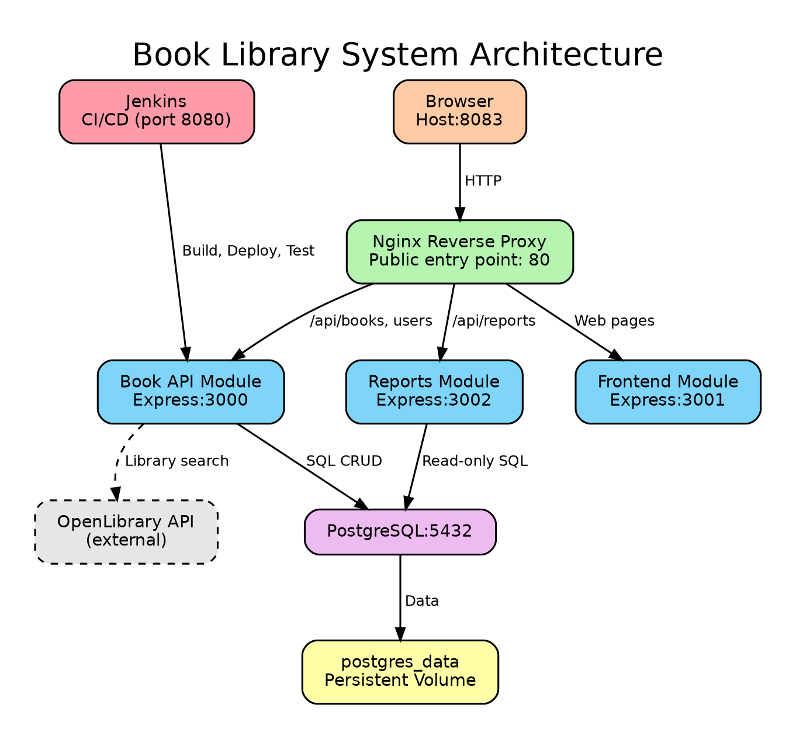

# Book Library System: Docker and Jenkins CI/CD Pipeline

A containerized, multi-module library management application with automated testing and a Jenkins CI/CD pipeline. Every push to the repository is checked out, tested, built, deployed, and smoke-tested automatically.

| | |
|---|---|
| **Group** | Techikaldag |
| **Course / Section** | ITE-302 (System Architecture and Integration) |
| **Instructor** | Doc. Harwin Mendoza |
| **Repository** | https://github.com/EronSG/BookLibrary-CI-CD |

---

## Table of Contents

1. [Project Description](#1-project-description)
2. [Architecture](#2-architecture)
3. [Technology Stack](#3-technology-stack)
4. [Prerequisites](#4-prerequisites)
5. [Getting Started: Run the Stack](#5-getting-started-run-the-stack)
6. [Starting Jenkins](#6-starting-jenkins)
7. [Trigger Configuration](#7-trigger-configuration)
8. [CI/CD Pipeline](#8-cicd-pipeline)
9. [Team Members and Roles](#9-team-members-and-roles)
10. [Documentation](#10-documentation)

---

## 1. Project Description

The Book Library System is a web-based application that demonstrates library management functions together with modern deployment practices: containerization, automated testing, and repeatable CI/CD.

The application is split into three Express.js modules, each running in its own Docker container:

| Module | Container | Port | Responsibility |
|---|---|---|---|
| **Book API** | `book-api` | 3000 | CRUD operations for books, library search through the external OpenLibrary API, and user and loan management (borrowing and returning books). Reads and writes PostgreSQL. |
| **Frontend** | `frontend` | 3001 | Serves the web pages users see in the browser. |
| **Reports** | `reports` | 3002 | Produces library statistics using read-only SQL queries. |

Supporting services: **PostgreSQL** (data storage), **Nginx** (reverse proxy and single public entry point), and **Jenkins** (CI/CD, deployed separately from the application).

Each backend module exposes a `/health` endpoint used by Docker health checks and the pipeline smoke test.

---

## 2. Architecture



### Request flow

1. The browser sends an HTTP request to Nginx on the published host port (default `8083`).
2. Nginx routes the request by path:
   - `/api/books`, `/api/users` → **Book API** (`:3000`)
   - `/api/reports` → **Reports** (`:3002`)
   - everything else (web pages) → **Frontend** (`:3001`)
3. Book API and Reports query **PostgreSQL**. Book API also calls **OpenLibrary** for library searches.
4. The response returns to the browser through Nginx.

### Containers, ports, networks, and volumes

| Service | Image / Build | Internal port | Exposed to host? |
|---|---|---|---|
| `proxy` | Built from `./nginx` | 80 | **Yes**: `${NGINX_PORT:-8083}:80` |
| `book-api` | Built from the application Dockerfile | 3000 | No (reachable only through Nginx) |
| `frontend` | Built locally | 3001 | No (reachable only through Nginx) |
| `reports` | Built locally | 3002 | No (reachable only through Nginx) |
| `database` | `postgres:17-alpine` | 5432 | No (only application containers reach it) |

- **Network:** all services share the user-defined network `app-private` and reach each other by service name.
- **Volumes:**
  - `postgres_data`: named volume mounted at `/var/lib/postgresql/data`, so database records survive container removal and redeployment.
  - `./database/init.sql`: mounted read-only into `/docker-entrypoint-initdb.d/` to create the schema on first start.
- **Health checks and startup order:** the database runs `pg_isready -U libraryuser -d library` every 5 seconds (5-second timeout, 10 retries). Application modules start only when the database is `healthy`, and the proxy starts after the application modules.

---

## 3. Technology Stack

| Technology | Purpose | Why we chose it |
|---|---|---|
| Node.js 22 + Express.js | Backend REST API and frontend server | Lightweight, quick to develop, well suited to modular REST endpoints. |
| PostgreSQL 17 | Data storage | Reliable relational database that fits books, users, and loans with relationships. |
| Docker | Containerization | Same environment on every machine; repeatable builds. |
| Docker Compose | Multi-container orchestration | Starts the whole stack with one command. |
| Nginx | Reverse proxy | Single public entry point; keeps the app and database off the public network. |
| Jenkins | CI/CD | Automates testing, image building, deployment, and smoke testing on each run. |
| Jest | Automated testing | Simple test runner for the Express API (`npm test`). |
| Git and GitHub | Version control | Shared repository for collaboration and Jenkins checkout. |
| OpenLibrary API | External search | Real book data without maintaining our own catalog. |

---

## 4. Prerequisites

Install the following on the machine that will run the stack and Jenkins:

- **Git**: `git --version`
- **Docker Desktop** (Windows/macOS, with WSL 2 on Windows) or Docker Engine (Linux): `docker version`
- **Docker Compose v2**: `docker compose version`
- **Node.js 22 + npm** (only needed to run tests outside Docker)
- At least **8 GB RAM** recommended (Jenkins plus the full stack is memory-hungry)

Free host ports: **8083** (application), **8080** (Jenkins). The Jenkins deployment uses **8084** for the application it deploys.

---

## 5. Getting Started: Run the Stack

```bash
# 1. Clone the repository
git clone https://github.com/EronSG/BookLibrary-CI-CD.git
cd BookLibrary-CI-CD

# 2. Create your environment file from the template
cp .env.example .env          # on PowerShell: Copy-Item .env.example .env
# edit .env and set your own values (never commit .env)

# 3. Build and start everything
docker compose up -d --build

# 4. Check that all containers are healthy
docker compose ps
```

Verify the deployment through Nginx:

```bash
curl http://localhost:8083/health
# {"status":"ok","database":"connected"}

curl http://localhost:8083/api/books
```

Open the application in a browser at **http://localhost:8083**.

To stop the stack (data is kept in the `postgres_data` volume):

```bash
docker compose down
```

> ⚠️ Do **not** use `docker compose down -v` unless you want to delete the database volume and all stored data.

### Environment variables

Configuration is passed through environment variables. `.env.example` documents the expected keys with placeholder values only. Real passwords are never committed to Git (`.env` is listed in `.gitignore`).

| Variable | Purpose |
|---|---|
| `NGINX_PORT` | Host port mapped to Nginx port 80 (default `8083`) |
| `DB_HOST`, `DB_PORT`, `DB_NAME` | Database connection settings |
| `DB_USER`, `DB_PASSWORD` | Database credentials |
| `POSTGRES_DB`, `POSTGRES_USER`, `POSTGRES_PASSWORD` | PostgreSQL container initialization |
| `NODE_ENV`, `PORT` | Application runtime settings |

---

## 6. Starting Jenkins

Jenkins runs **inside a Docker container** built from `Dockerfile.jenkins` (see `infra/jenkins/`). It is deployed separately from the application stack so the pipeline never redeploys Jenkins itself, and it has access to Docker Desktop on the host machine to build and deploy containers.

```bash
cd infra/jenkins

# Build and start Jenkins
docker compose up -d --build
```

Then:

1. Open **http://localhost:8080**.
2. Unlock Jenkins with the initial admin password:
   ```bash
   docker compose logs jenkins
   # or: docker exec <jenkins-container> cat /var/jenkins_home/secrets/initialAdminPassword
   ```
3. Install the suggested plugins (**Pipeline** and **Git** are required).
4. Create the pipeline job (see below).

### Pipeline job configuration

| Setting | Value |
|---|---|
| Job name | `BookLibrary-CI-CD` |
| Definition | Pipeline script from SCM |
| SCM | Git |
| Repository URL | `https://github.com/EronSG/BookLibrary-CI-CD` |
| Credentials | none (public repository). For a private repo, add a GitHub token under *Manage Jenkins → Credentials* |
| Script path | `Jenkinsfile` (repository root) |

---

## 7. Trigger Configuration

The pipeline starts **automatically** when new code is pushed. No one needs to press *Build Now*.

Under *Configure → Triggers*, the job uses:

- ✅ **GitHub hook trigger for GITScm polling**
- ✅ **Poll SCM** with schedule:

```
H/2 * * * *
```

Poll SCM checks the repository roughly every 2 minutes and starts a build when it finds a new commit. This works even when Jenkins is only reachable on a laptop or lab network and cannot receive a GitHub webhook. If Jenkins is exposed publicly, add a webhook in GitHub (*Settings → Webhooks → `http://<jenkins-host>:8080/github-webhook/`*) for instant triggering.

---

## 8. CI/CD Pipeline

The pipeline is defined as code in the `Jenkinsfile` at the repository root (declarative pipeline).

| # | Stage | What it does | On failure |
|---|---|---|---|
| 1 | **Checkout SCM / Checkout** | Pulls the latest source code from GitHub. | Pipeline stops; nothing is built or deployed. |
| 2 | **Check Docker** | Verifies that Docker and Docker Compose are available. | Pipeline stops; fix the environment first. |
| 3 | **Test** | Starts the database and runs `npm install` and `npm test` in a container. | **Quality gate:** a failing test fails the build, so no image is built and nothing is deployed. |
| 4 | **Build** | Builds the Docker images, tagged with the Jenkins build number (and `latest`). | Pipeline stops; the running deployment is unchanged. |
| 5 | **Deploy** | Runs `docker compose up -d --build` to redeploy the stack. | Pipeline stops; check the compose logs. |
| 6 | **Smoke Test** | Lists running containers and calls `/health` with `curl --fail`. | Build is marked failed because the app is not responding correctly. |
| 7 | **Post Actions** | Always runs `docker compose ps` and reports the pipeline result. | n/a |

Jenkins stops at the first failed stage. Because tests run **before** Build and Deploy, broken code never reaches the running system.

## 9. Team Members and Roles

| Member | Role | Responsibilities |
|---|---|---|
| **Christian Paalan** | Project Lead and Documentation | Coordinates project activities, maintains documentation, and monitors completion of requirements. |
| **Neo Yabut** | Application Developer | Develops and maintains the Express.js application and its functional modules. |
| **Aleron Gonzales** | Containerization and Infrastructure | Configures Docker, Docker Compose, PostgreSQL, and Nginx. |
| **Yahha Arceo** | CI/CD and Testing | Configures Jenkins and verifies the pipeline results. |
| **Andrei Jeremy Garcia** | CI/CD and Testing | Maintains automated tests and verifies the pipeline results. |

---

## 10. Documentation

The full technical documentation (architecture, Dockerfile and Compose explanations, Jenkins setup, pipeline stages, testing strategy, rollback and persistence proof, with screenshots) is available at [`docs/technical-documentation.pdf`](docs/technical-documentation.pdf).

---

*Submitted October 17, 2026 for ITE-302, Doc. Harwin Mendoza.*
